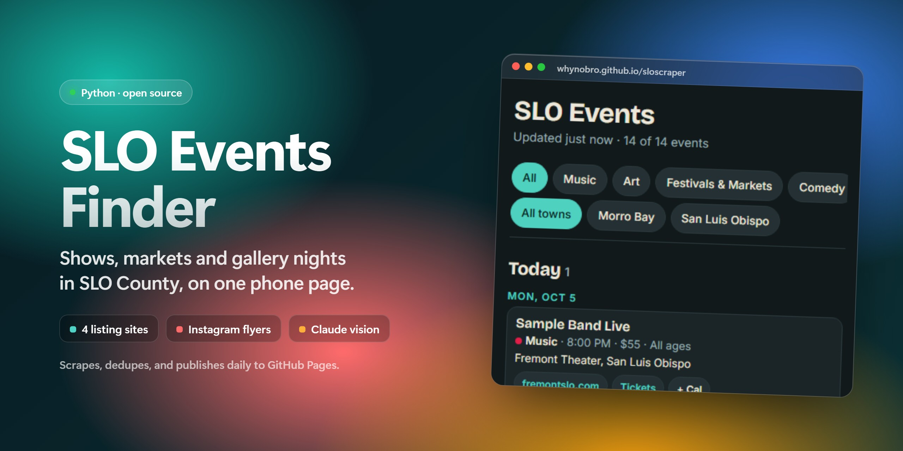
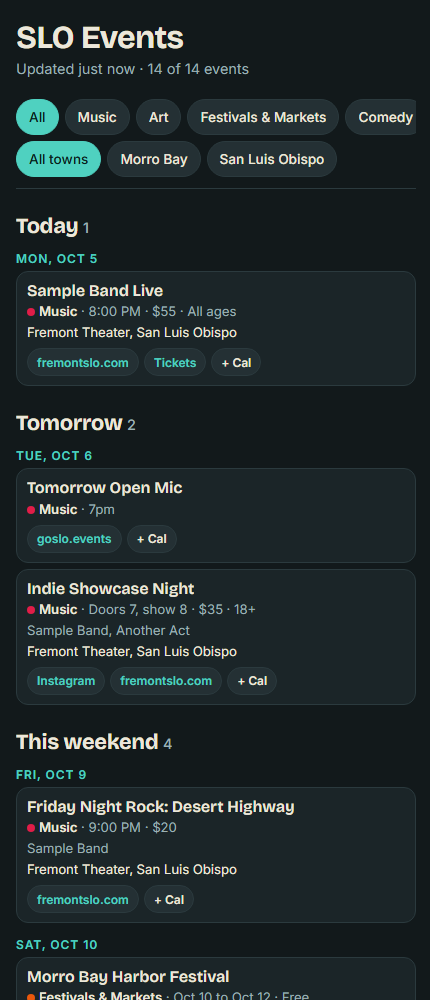
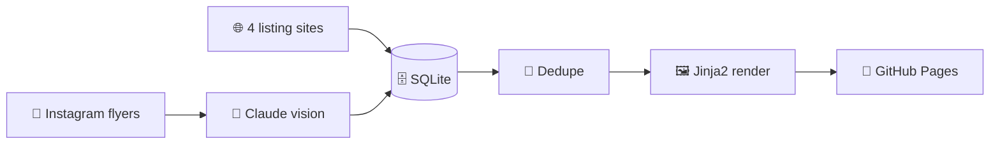

<a href="https://whynobro.github.io/sloscraper/"></a>

<p align="center">
  
  
  
  
  <a href="https://github.com/whynobro/sloscraper/commits/main"></a>
</p>

<h3 align="center">One daily job that gathers San Luis Obispo County events<br>from listing sites and Instagram flyers, then publishes a clean phone page.</h3>

<p align="center">
  <a href="https://whynobro.github.io/sloscraper/"><b>Open the live page</b></a>
  &nbsp;·&nbsp; <a href="#-how-it-works">How it works</a>
  &nbsp;·&nbsp; <a href="#-getting-started">Getting started</a>
  &nbsp;·&nbsp; <a href="#%EF%B8%8F-configuration">Configuration</a>
  &nbsp;·&nbsp; <a href="#-folder-map">Folder map</a>
</p>

<p align="center"></p>

SLO Events Finder scrapes four local event listing sites, reads event flyers posted on Instagram with Claude vision, merges duplicates, and renders one mobile-friendly page that is published to [GitHub Pages](https://whynobro.github.io/sloscraper/). Events are grouped into Today, Tomorrow, This weekend, Rest of this week, Ongoing and Later, with category and town filters and an add-to-calendar link on every card. The screenshot above uses sample data.

## ✨ Features

| | |
|---|---|
| 🌐 **Four listing sources** | goslo.events, fremontslo.com, hellomorrobay.com (Tribe Events REST API) and community.newtimesslo.com. |
| 📸 **Instagram flyers** | Pulls new posts from venue and organizer accounts listed in `config/sources.yaml`, then extracts events from the flyer and caption. |
| 🧠 **Claude vision extraction** | Flyer image plus caption go to a Claude model (Haiku 4.5) that returns structured events with date, venue, town, time, price and age limit. |
| 🧹 **Smart dedupe** | Fuzzy title matching (RapidFuzz) merges the same event seen in several sources and keeps every source link. |
| 🗓️ **Phone-first page** | Time-grouped sections, category and town filter chips, ticket links, and a one-tap Google Calendar link per event. |
| 🛡️ **Failure isolated** | Each source runs on its own. One broken scraper is logged and the rest of the run carries on. |
| 📈 **Yield report** | Every run logs events and unique events per source, plus any errors. |
| 🔁 **Never pays twice** | Instagram posts already seen are stored in SQLite and are never sent to Claude again. |

## 🧭 How it works



1. **Listings:** each scraper in `slo_scraper/listings/` returns normalized events.
2. **Instagram (optional):** new posts are fetched with a saved burner-account session, then pending posts are extracted by Claude.
3. **Store:** everything lands in a local SQLite database under `data/`.
4. **Dedupe and render:** upcoming events are merged and rendered to `site/index.html`.
5. **Publish:** `ghp-import` pushes `site/` to the `gh-pages` branch (no force push).

## 🚀 Getting started

```sh
pip install -r requirements.txt
cp .env.example .env        # then fill in the values (see Configuration)

python run.py --no-ig       # listings only: no Instagram, no Claude key needed
python run.py               # full run: listings + Instagram + publish
```

CLI flags for `run.py`:

| Flag | Effect |
|---|---|
| `--no-ig` | Skip the Instagram fetch and the Claude extraction. |
| `--no-publish` | Render the page but do not push to `gh-pages`. |
| `--db PATH` | Use a different SQLite file (default `data/events.db`). |
| `--out DIR` | Output directory for the rendered site (default `site`). |

Try it safely without publishing: `python run.py --no-ig --no-publish`, then open `site/index.html`.

**Run it daily on Windows:** `scripts/install_task.ps1` registers a scheduled task named `SLOEvents` that runs `python run.py` every day at 10:00 and appends output to `data\run.log`.

**Tests:** `python -m pytest tests/`

**Check flyer extraction accuracy:** `python scripts/eval_extract.py` runs the extractor over the flyer fixtures in `tests/fixtures/flyers/` and prints hits and misses (needs `ANTHROPIC_API_KEY`).

## ⚙️ Configuration

Secrets live in `.env`, which is gitignored. Copy `.env.example` and set:

| Variable | Used for |
|---|---|
| `ANTHROPIC_API_KEY` | Claude vision extraction of Instagram flyers. |
| `IG_USERNAME` | The burner Instagram account whose saved session is reused. |

`config/sources.yaml` lists the listing sites and the Instagram handles (grouped by category) to watch. Edit it freely.

**Instagram guardrails:**
- Use a burner account only, never your main one.
- The scraper never logs in by itself: it reuses a session file you create beforehand, for example `instaloader --login <burner> --sessionfile data/session-<burner>`.
- Run it from a home PC only, never from CI or GitHub Actions.
- Never commit `.env`, `data/`, or session files (all are gitignored).

## 🧱 Tech stack

| Area | Tools |
|---|---|
| Language | Python |
| Scraping | `requests`, `beautifulsoup4`, `instaloader` |
| Extraction | Anthropic API (Claude vision), `pillow` for image resizing |
| Dedupe | `rapidfuzz` |
| Storage | SQLite |
| Output | `jinja2` template, `ghp-import` to GitHub Pages |
| Config and tests | `pyyaml`, `python-dotenv`, `pytest` |

## 📁 Folder map

```text
run.py                  pipeline entry point (CLI)
config/sources.yaml     listing URLs and Instagram handles
slo_scraper/
  models.py             Event and Post types (shared contract)
  store.py              SQLite storage
  listings/             one scraper per listing site
  ig_fetch.py           Instagram fetcher (saved session)
  extract.py            Claude vision extraction
  dedupe.py             merge duplicate events
  render.py             build the page from events
  templates/            Jinja2 page template
  publish.py            push site/ to gh-pages
scripts/                install_task.ps1, eval_extract.py
tests/                  pytest suite and fixtures
```

## 📄 License

No license file is included in this repository yet, so all rights are reserved by default. Open an issue if you would like to reuse the code.
